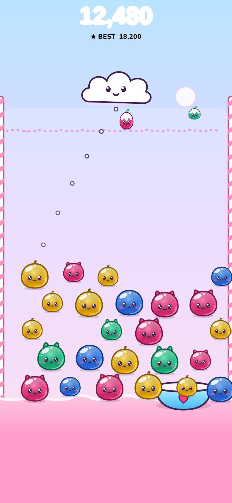
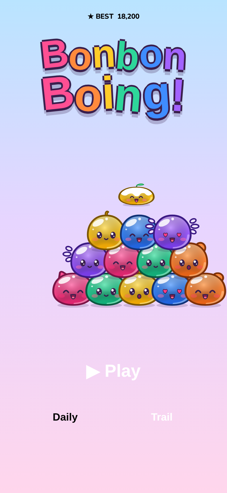
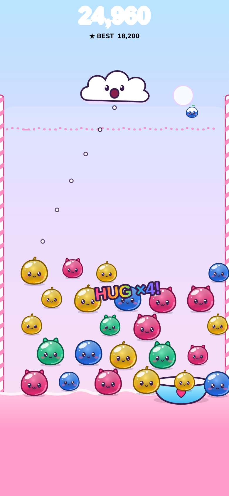
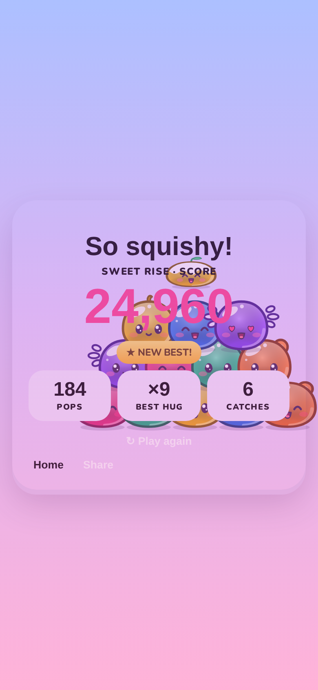

# Bonbon Boing!

**Bonbon Boing!** is a squishy bounce-and-pop puzzle for phones: aim **Pip** from **Puff** the cloud, borrow colours on bump, and pop hug chains before the Bonbons reach the icing line.

Play: [**AieatAssam.github.io/bonbon-boing/**](https://aieatassam.github.io/bonbon-boing/)



## How to play

1. **Drag** anywhere in the field to aim; **release** to launch Pip.
2. Bump a Bonbon to **borrow** its colour (coat splat on Pip).
3. Bump a Bonbon that **matches your coat** to **pop** it and start a **hug chain** of same-colour neighbours.
4. Swap the next Pip with the **Next** bubble (tap or `S`).
5. Catch Pip in the **Cuddle Cup** for a bonus — no rise that turn!

**Modes**

| Mode | Entry | Rules |
|---|---|---|
| **Sweet Rise** | Play | Endless rising field, Sugar Rush once, stages every 12 shots |
| **Daily Treat** | Daily | Seed `bonbon-YYYY-MM-DD`, 40 shots, streak |
| **Sweet Trail** | Trail | 30 levels, pop all ♥ Hearts, stars |

Character gallery: append `?gallery` or `?qa&screen=gallery`.

## Controls

- **Touch**: drag aim, release fire; two-finger tap swap
- **Mouse**: move aim, click fire, right-click swap
- **Keyboard**: arrows aim, Space fire, S swap, P/Esc pause, M mute

## Tech

Vite 6 · TypeScript (strict) · Canvas2D field · DOM HUD · Vitest · Playwright layout QA · PWA · GitHub Pages (`/bonbon-boing/`).

```bash
npm install
npm run dev          # local dev
npm run build        # production (runs token gen)
npm test             # unit tests
npm run qa:layout    # six viewports × screens (+ overlap check)
npm run balance      # bot harness → docs/balance.md
```

## Screenshots

| Title | Combo | Results |
|---|---|---|
|  |  |  |

More captures: `qa/shots/*` (CI artifact on `main`).

## Inspirations

Inspired by **Peggle** (aim, ladder, Fever), **Puzzle Bobble** (colour match + swap), **Suika Game** (cute physics, no timer), **Squishmallows** (plush look), **Kirby** (faces never stretch), and others listed in [CREDITS.md](CREDITS.md).

> Bonbon Boing! is an independent fan-made game. It is not affiliated with, endorsed by or sponsored by PopCap/EA, Taito, Aladdin X, Disney, SEGA, Sony, Nintendo/HAL Laboratory, Jazwares or Mediatonic. All names are trademarks of their owners.

## Licence & assets

- Code: [MIT](LICENSE)
- Audio: CC0 — see [CREDITS.md](CREDITS.md) and `assets-src/audio/SOURCES.md`
- Fonts: Fredoka & Nunito (SIL OFL 1.1)

**Suggested repo topics:** `puzzle-game` `html5-game` `browser-game` `typescript` `vite` `canvas` `pwa` `kawaii` `cute` `physics` `soft-body` `peggle-like` `bubble-shooter` `cc0-audio` `mobile-game`
