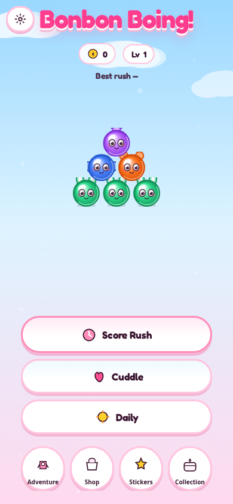
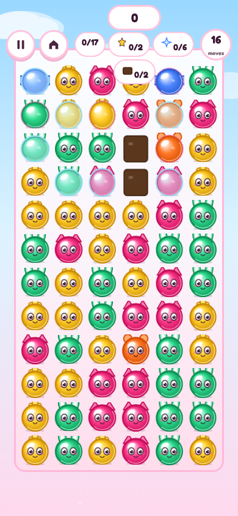
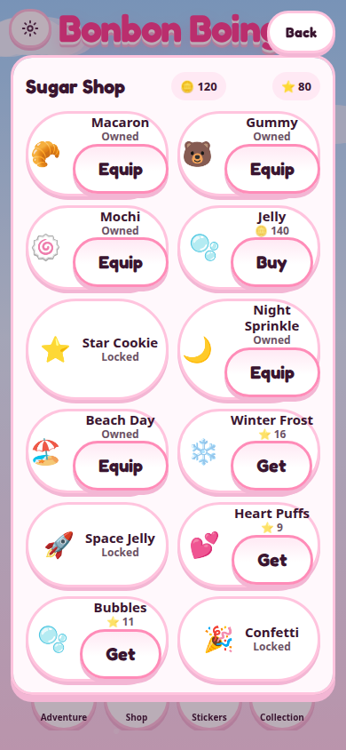
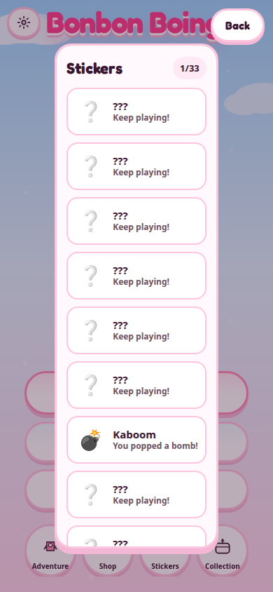
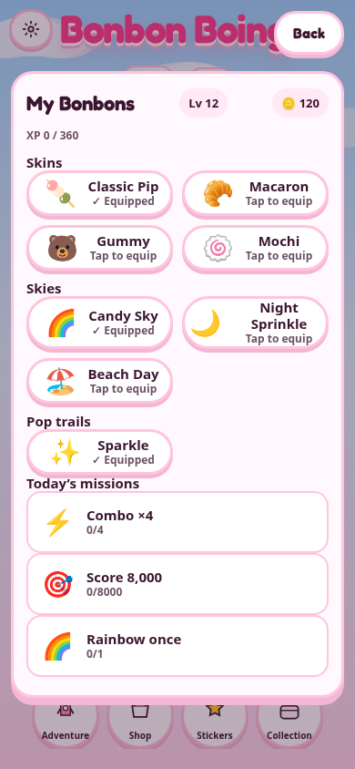
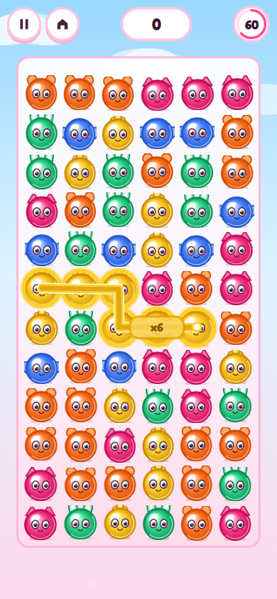

# Bonbon Boing!

**Squish Chain** — drag through cuddly same-colour bonbons, release to pop. Five-link chains sprout **Boing Bombs**; seven-link hugs drop **Rainbows**. String quick pops for combo ×2–×5. Kids can read the icons; adults can chase scores, Adventure stars, and cosmetics.

[Play now](https://aieatassam.github.io/bonbon-boing/)


## How to play

1. **Drag** through touching bonbons that share a colour (Rainbows match any colour).
2. **Release** to squish-pop — each note climbs the squeak ladder.
3. **Boing Bomb** (5+ chain): drag through the bomb to pop neighbours.
4. **Rainbow** (7+ chain): clears that colour from the board.
5. **Starburst** (Adventure level 25+): on a 5–6 link chain you have an **18%** chance to spawn a sparkly 3×3 blast instead of a bomb.

The first visit shows a glossy white-glove hint (no wall-of-text tutorial). Drag back along the chain to undo the last step.

## Modes

| Mode | Button | What it is |
|------|--------|------------|
| **Score Rush** | Score Rush | 60-second scored round — the main hustle. |
| **Cuddle** | Cuddle | Same juicy pops, no clock. |
| **Daily** | Daily | One shared board per local day (`bonbon-YYYY-MM-DD`). |
| **Adventure** | Adventure | 60 goal levels in four chapters — ice, choco, jelly, sleepy giants. |

## Meta & collection

- **Sugar Stars** ⭐ — earn from runs, missions, and Adventure stars; spend in the **Shop**.
- **Coins** 🪙 — earn from runs and missions; buy coin-priced skins such as **Macaron** (🪙 55 in the Shop once you own the gates).
- **Bonbon skins** — classic plush, macaron, gummy, mochi, jelly bean, star cookie (shape + colour marks for colour-blind play).
- **Board themes** — candy sky, night sprinkle, beach, winter frost, space jelly.
- **Pop trails** — sparkle, hearts, bubbles, confetti.
- **Stickers** — 30+ achievements with toasts.
- **Daily missions** — three quick goals per day.
- **Play streak** — gentle login streak with a weekly bump.
- **Player XP** — level up for shop gates.

Everything saves in `localStorage` (`bonbon-boing-v3`) with migration from older saves.

## Controls

- **Pause** / **Home** on the HUD; **Back** / **Esc** opens pause then menu.
- **Settings** (gear, top corner): **Sound** / **Music** toggles persist.
- Title shortcuts: **Adventure**, **Shop**, **Stickers**, **Collection** (each opens a scrollable panel).

## Tech

Vite 6 · TypeScript (strict) · Canvas2D · Vitest · Playwright · PWA · GitHub Pages (`/bonbon-boing/`).

```bash
npm install
npm run dev
npm run build
npm test
npm run qa:layout
```

QA hooks: `?qa` exposes `window.__qa` (no audio context). Layout captures: `&screen=title|play|…&freeze=1`.

## Screenshots

| Title / Map | Adventure | Shop |
|-------------|-----------|------|
|  |  |  |

| Stickers | Collection | No crop (mid-pop) |
|----------|------------|-------------------|
|  |  |  |

## Credits & licence

- Code: [MIT](LICENSE)
- Audio: CC0 — see [CREDITS.md](CREDITS.md) and `assets-src/audio/SOURCES.md`
- Fonts: Fredoka & Nunito (SIL OFL 1.1)
- Meta design patterns inspired by [Gloop Pop](https://github.com/AieatAssam/gloop-pop) (shop, adventure map, missions).
- Tutorial pointer glove is drawn in-engine; silhouette inspired by Kenney Cursor Pack (CC0) — see [CREDITS.md](CREDITS.md).

Bonbon Boing! is an independent fan-made game. It is not affiliated with, endorsed by or sponsored by PopCap/EA, Taito, Aladdin X, Disney, SEGA, Sony, Nintendo/HAL Laboratory, Jazwares or Mediatonic. All names are trademarks of their owners.

**Suggested repo description:** Squish Chain puzzle — drag same-colour bonbons, bombs, rainbows, 60s rounds, Adventure map, skins & stickers.

**Suggested topics:** `puzzle-game` `html5-game` `browser-game` `typescript` `vite` `canvas` `pwa` `kawaii` `cute` `mobile-game` `match-game` `casual-game` `adventure-mode` `achievements`
