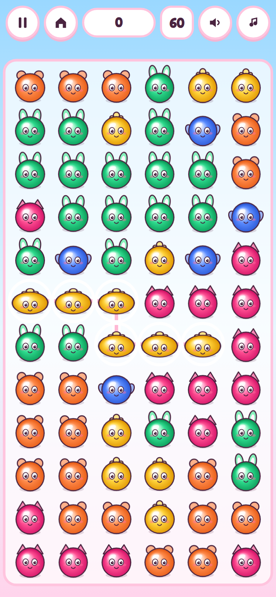
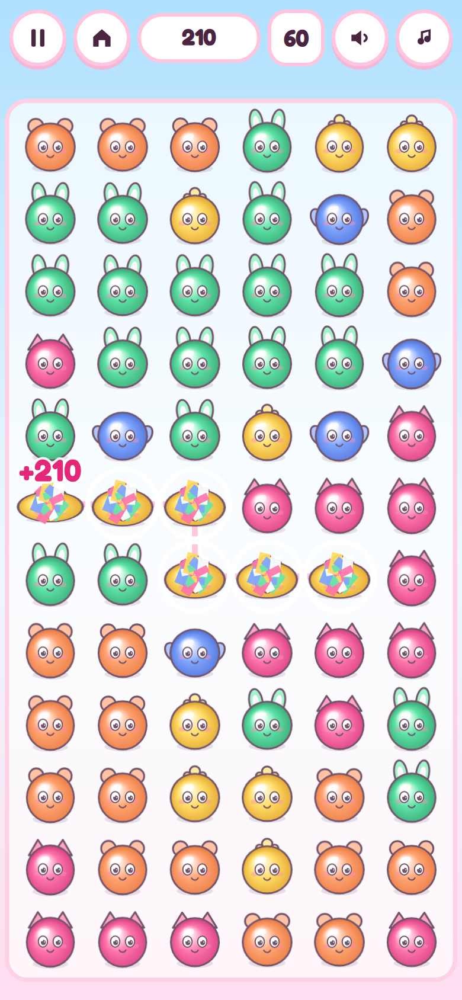

# Bonbon Boing!

**Bonbon Boing!** is Squish Chain, a squishy connect-and-pop puzzle for phones. Drag through bonbons that touch and share a colour, let go, and they squish-pop up a squeaky note ladder. Long chains drop a Boing Bomb or a Rainbow. Play a 60-second round, an untimed Cuddle mode, or the daily board.

Play now: https://aieatassam.github.io/bonbon-boing/



## How to play

Drag through bonbons that are touching and the same colour. A Rainbow counts as any colour. Release and they squish-pop. Each pop plays the next squeak in the ladder.

- A chain of 5 or more drops a **Boing Bomb**. Drag through the bomb and the candies around it pop too.
- A chain of 8 or more drops a **Rainbow**. Popping it clears that colour.
- Pop again quickly and the score combo climbs.

The first visit shows a ghost hand. The round itself has no instructions to read.

**Modes**

| Mode | What it is |
|---|---|
| **60-second round** | The play button. Score as much as you can before the clock ends. |
| **Cuddle** | The heart. Same pops, no clock. |
| **Daily** | The sun. One shared board for the local day, seed `bonbon-YYYY-MM-DD`. |

## Controls

- **Drag** through same-colour bonbons and **release** to pop. Drag back along the path to undo the last step.
- **Pause** and **Home** stay on screen during play. Pause freezes the round and offers Resume, Restart and Home.
- **Esc** or the browser **Back** button opens pause, then the menu. They stay inside the game.
- **Sound** and **music** buttons mute each bus. The choice is remembered.

## Tech

Vite 6 · TypeScript (strict) · Canvas2D · DOM HUD · Vitest · Playwright · PWA · GitHub Pages (`/bonbon-boing/`).

Every bonbon is one size, `D`. Sprites are cached per colour and size. The frame loop does not use `ctx.filter` or blur.

```bash
npm install
npm run dev
npm run build
npm test
npm run qa:layout
```

`?qa` installs `window.__qa` (chains, pause, pump) and never opens an audio context. Layout shots use `&screen=title|play|chain|pop|pause|results&freeze=1`.

## Screenshots

| Title | Chain | Pop |
|---|---|---|
|  |  |  |

## Inspirations

Inspired by **Peggle** (the rising squeak ladder), **Puzzle Bobble** (colour pops), **Suika Game** (cute round characters), **Squishmallows** (plush look), **Kirby** (faces stay round), connect-and-pop puzzles, and **Gloop Pop** (gloss and juice).

> Bonbon Boing! is an independent fan-made game. It is not affiliated with, endorsed by or sponsored by PopCap/EA, Taito, Aladdin X, Disney, SEGA, Sony, Nintendo/HAL Laboratory, Jazwares or Mediatonic. All names are trademarks of their owners.

## Licence & assets

- Code: [MIT](LICENSE)
- Audio shipped in the repo: CC0. See [CREDITS.md](CREDITS.md) and `assets-src/audio/SOURCES.md`. The round itself plays a procedural squeak ladder and a soft procedural lullaby, so the first tap is never waiting on a download.
- Fonts: Fredoka & Nunito (SIL OFL 1.1)

**Suggested repo topics:** `puzzle-game` `html5-game` `browser-game` `typescript` `vite` `canvas` `pwa` `kawaii` `cute` `physics` `soft-body` `peggle-like` `bubble-shooter` `cc0-audio` `mobile-game`
